<!-- ═══════════ ANIMATED PERSONAL COVER ═══════════ -->

 
 

<!-- ═══════════ SNAKE ANIMATION ═══════════ -->

 

<picture>
  <source media="(max-width: 640px)" srcset="assets/about-me-mobile.svg">
  
</picture>

<!-- Temporarily hidden; preserved for later reuse.
<h3>Languages and Tools</h3>

  
  
  
  
  
  
  

-->
